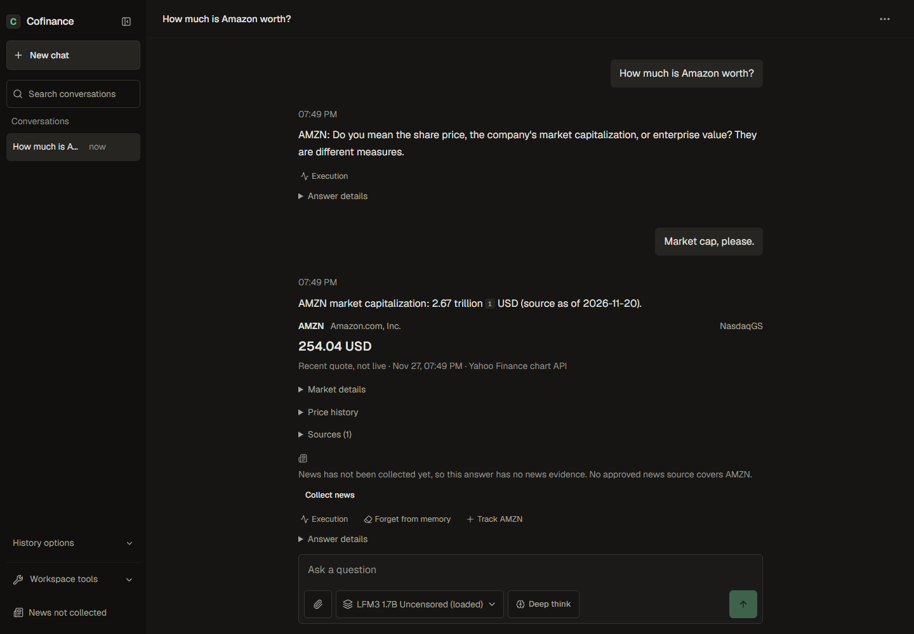
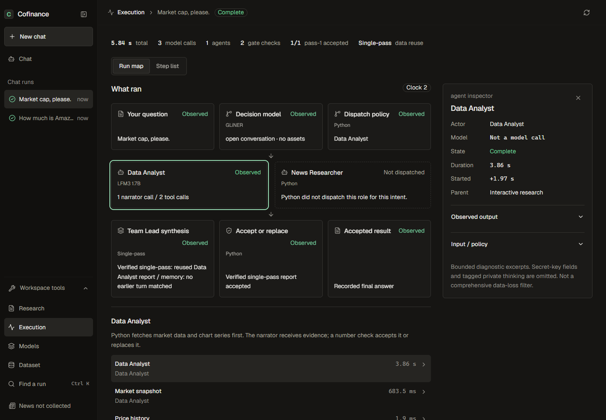

# Cofinance

A local finance-research workspace for stocks and crypto. Ask about an asset, and specialist agents gather market data and collected news, a local model writes the answer, and every step, source and check is open to inspect. Conversations and memory stay on your PC.

**v2, in development.** React dashboard, Python policy, local inference only. Not production-ready, not a trading system and not financial advice. Cofinance never trades.

[Start](#start) · [How it works](#how-it-works) · [Models](#models) · [What we measured](#what-we-measured) · [Crowd odds](#crowd-odds-read-only) · [Development](#development) · [Open work](#open-work)

## Preview

Captured 2026-11-09 with a purpose-created public NVDA conversation; no private chats are shown. Later builds changed the default narrator and added the experimental headline card, so details differ from the current screen.



Chat, source-backed figures and the locally rendered chart.



The same run's map. Steps that did not run are shown as unused, never as passed.

## Start

### On an already configured Windows PC

1. Double-click `run-dashboard.cmd` in the repository root.
2. Open <http://127.0.0.1:8878> in a regular browser. Keep the terminal open.
3. In **Models**, download, verify and qualify the default narrator, **LFM3 1.7B Uncensored** (AtomicChat). The original **LFM3 1.7B** is an optional download in the same view; a choice you made before is kept.
4. Collect news, then ask about an asset. Open the answer's run map to see sources, routing, model calls, guard checks and fallbacks.

The launcher builds the React frontend and starts the Python service. Node.js is needed for the build; Python and the local inference packages must already be installed. Do not start a second server if the address is already in use. After a build, serving does not need Node:

```text
python -E -B -m ui.dashboard --port 8878
```

This is not a fresh-install recipe yet: `requirements.txt` still mixes v1 and v2 dependencies, and the pinned GLiNER cache and the optional Hy-Memory environment need separate setup. No hosted-model key is needed. [Dashboard setup, API and security details](frontend/README.md)

## How it works

Python owns dispatch, data fetching, validation, persistence and every write. Models classify or narrate; they have no tool or write authority, and no number reaches you unless a tool produced it.

```text
News (Clock 1, collected when you click Collect news)
  official feeds + shared links -> pre-gate -> GLiNER judge -> rule urgency -> signal gate -> local news store
                                                         -> each new headline judged once (experimental card)

Chat (Clock 2)
  question -> GLiNER router (loaded at startup)
           -> Data Analyst: market tools, narrated report
           -> News Researcher: Python digest of the served headlines, no model call
           -> news-only question: Python answer (digest + listed risks), no model call
           -> otherwise Team Lead: narrated answer -> number, wording and risk guards
           -> accepted answer, one retry, or a deterministic fallback
           -> crowd odds card, Python only, never narrated
```

- **Research:** provider-backed market snapshots, fundamentals, price charts and accepted news. Chat reads collected news; it never refreshes it silently.
- **News:** headlines are quoted verbatim and grouped by their one source (company announcements, shared links). The narrator rewrote them into new claims in four tested prompt and guard variants, so this step is code.
- **Visibility:** the run map shows actual model calls, dispatch decisions, tool outputs, retries and validation. A missing step is never shown as successful. No hidden reasoning is exposed or invented.
- **Token usage:** each new answer shows runtime-reported narrator input, output and total tokens, with a per-role breakdown. Retries and rejected output count; missing usage is unavailable or partial, never estimated. These are summed call totals, not context-window occupancy. GLiNER routing, memory embeddings and separate news collection are excluded. Older answers have no counts.
- **Conversations:** persistent, searchable history; New chat opens a blank draft and saves nothing until you send. Cancellation, same-asset follow-ups and explicit asset tracking. Research, Execution, Models and Dataset sit under Workspace tools; memory and export under Conversation options. The sidebar collapses on desktop and becomes a drawer on phones. Research never adds to the watchlist on its own.
- **Deep think (optional, off by default):** a composer switch that lets the narrator think up to 384 tokens before the final answer, on a second local server started only when asked. It stays disabled until Models > Test deep think passes the same frozen smoke gates with thinking on. In the dev screen it cost about 2.5 s instead of 0.4 s per answer and made headline ranking worse (AUC 0.508 vs 0.625), so headline judging and the specialist agents never think. The thinking text is never shown or saved, and the answer goes through the same number and wording checks. [Result](docs/benchmarks/THINK_LAB.md)
- **PDFs:** attach up to 5 text PDFs per conversation (20 MB and 300 pages each) with the paperclip. A separate process reads the text with a 30 s limit; scanned and password-protected files are refused, there is no OCR. For each question Python quotes up to 3 matching pages, and the answer may only use numbers from those quotes. The pages used are listed under the answer. A question with no asset is answered from the files. Removing a file or deleting the conversation deletes its stored text.
- **Memory:** hybrid keyword + Hy-Memory lite by default, with keyword fallback. Notes and recalled turns are context only, never evidence. Override with `COFINANCE_MEMORY=keyword`, `hymemory` or `hybrid`. Remember a note, forget one item or a conversation's memory, delete a conversation or clear all. [Memory design](docs/designs/remember_forget.md)

## Models

| Component | Role | Runtime policy |
| --- | --- | --- |
| `fastino/GLiNER2.5-Decide` (486,444,053 parameters) | Route questions, classify headlines | Pinned local cache; never generates answers |
| **LFM3 1.7B Uncensored, AD-Q4_K_M** (AtomicChat) | Narrate the Data Analyst report and Team Lead answer; judge headlines | **Default.** Pinned by SHA-256, qualified on its own; llama.cpp Vulkan GPU build with a qualified CPU fallback |
| LFM3 1.7B, Q4_K_M (Liquid AI) | Same jobs | Optional download; pinned and qualified on its own |
| Hy-Memory lite + Qwen3-Embedding-0.6B | Semantic conversation recall | Optional local worker; keyword fallback |

The agent roles are separate calls to the selected narrator, not separate models. Headline judgments are stored per narrator, so switching never mixes two models' judgments. The narrator is a small model: it is good at short, checkable text, not at deciding. [AtomicChat versus base](docs/benchmarks/NARRATOR-CANDIDATE.md) · [GPU and CPU speed](docs/benchmarks/SPEED.md)

## What we measured

> [!WARNING]
> **Experimental measurements of a research tool.** None is a trading signal or financial advice. Each links to its method, limits and result file.

**Short version: the system is grounded and inspectable, and no predictive edge has been demonstrated.** Direction skill is scored as ranking AUC, where 0.50 is no skill whatever the market did, and probabilities by Brier against the crowd.

| Question | Answer so far | Details |
| --- | --- | --- |
| Are the numbers in answers real? | 1,006 of 1,006 numbers in replayed answers and summaries trace to a tool value or a served headline | [Scorecard](docs/SCORECARD.md) |
| Does a price-only forecast predict direction? | No: UP on all 125 cases, balanced accuracy 50% | [Historical](docs/benchmarks/HISTORICAL.md) |
| Do simple rules beat always-UP over 12 years? | No direction rule passes; dual momentum cut dev drawdown from 59% to 20% | [Lab](docs/benchmarks/LAB.md) |
| Does the full team predict direction at past dates? | No edge demonstrated: UP on every valid call | [Replay](docs/benchmarks/REPLAY.md) |
| Best decision technique on dev data | The model judges each headline, Python sums the judgments: AUC 0.585 (base) and 0.625 (AtomicChat) on 72 correlated cases with known outcomes | [Replay](docs/benchmarks/REPLAY.md) |
| Does it hold on an unseen window? | Passed its frozen rule, on thin evidence: AUC 0.681 (interval 0.619 to 0.857) on 24 of 40 sealed cases, only 3 origins, a falling week (4 of 24 rose). Simply counting the gate's headline labels scored 0.663 on the same cases. Scored early on 2026-11-19, so the last 16 cases are never scored | [Result](docs/benchmarks/window-2026-11-09-headline-result.json) |
| Do market regimes or news follow-through improve calls? | Neither passed: the price model had no demonstrated skill across eight annual folds; follow-through ranked the reused news cases better overall but made fewer calls with lower balanced accuracy | [Price and news experiments](docs/benchmarks/PRICE_NEWS_METHODS.md) |
| Does reviewing headline evidence improve judgments? | The surprise checker covers no actual cached titles; compare the independent quote-review screen against both the unchanged judge and an asset-name rule | [Reviewed headlines](docs/benchmarks/REVIEWED_HEADLINES.md) |
| Is the Polymarket crowd calibrated? | Fairly, a day and a week out | [Polymarket](docs/benchmarks/POLYMARKET.md) |
| Our Bitcoin threshold model versus the crowd | The crowd is better a day out | [BTC vs crowd](docs/benchmarks/BTC_VS_CROWD.md) |
| Does a tuned Python baseline catch the crowd, or add to it? | No: fat tails help slightly but the crowd stays ahead, and adding the price model to the crowd's price does not help | [Baseline](docs/benchmarks/BTC_BASELINE.md) |
| Narrator probability versus the crowd | Recording forward, nothing scored. Record 1: about 0.99 YES on all 18 markets, including pairs that cannot both happen | [Polymarket replay](docs/benchmarks/PM_REPLAY.md) |
| Can a probability be read from the narrator at all? | No: on questions answered by its own price card, none of three readouts is coherent (first-token YES on everything, a JSON label with half its threshold steps rising, a stated number that is mostly 55) | [Readout check](docs/benchmarks/READOUT_CHECK.md) |
| Weekly forward forecasts | In progress; no claim before 26 matured batches | [Forward](docs/benchmarks/FORWARD.md) |
| Volatility as a risk flag | Not confirmed on new assets | [Risk lab](docs/benchmarks/RISK_LAB.md) |

[Every measurement side by side](docs/SCORECARD.md) · [Method note: how results are kept honest](docs/METHOD.md)

## Crowd odds (read-only)

Chat can show a small **Crowd odds** card for BTC, ETH and some stocks: live Polymarket prices picked and formatted by Python, never narrated and never used as evidence. Lookups are keyless GETs to Polymarket's public APIs only; there are no orders, keys or wallets. Disable with `COFINANCE_CROWD_ODDS=off`.

## Safety and local data

- **No hosted inference.** Model calls stay local; market providers and approved news and download sources still need the network.
- **Guarded output, not perfect verification.** Number, scale, wording, direction and supported-risk checks reject unsupported text, with at most one retry before the fallback. Value matching and lexical checks do not prove every claim.
- **Explicit side effects.** Watchlist edits, collections, model downloads and conversation controls are user actions. The API binds to loopback and checks host, origin and request tokens.
- **Private local state.** `data/` holds databases, traces, models and corpora and is git-ignored. Deletion uses tombstones, vector sweeps and SQLite `secure_delete`; a failed vector delete stays pending for retry. This is not a guarantee of forensic erasure from backups or the device.

## Development

```text
python -m unittest discover -s tests -t .
cd frontend
npm ci --ignore-scripts
npm test
npm run build
```

`python dev.py` wraps the routines: `test` (add `--bg`, then `python dev.py wait suite`), `run --bg NAME -- <command>`, `status`, `wait NAME`, `news`, `forward record|score`, `dashboard` and `features`. Logs go to `data/_logs/`.

The full backend suite needs the installed inference packages; tests never touch the network unless opted in. `COFINANCE_HYMEMORY_TESTS=1` enables real Hy-Memory checks and `COFINANCE_BROWSER_TESTS=1` installed-Chrome checks. Repository rules (frozen files, import boundaries, no hosted endpoints, benchmark warnings) are tests in `tests/test_invariants.py`. For frontend work, run the Python server, then `npm run dev` in `frontend/` (Vite on loopback port 5173, proxying the local API).

## Open work

- **A forecasting layer that is checked before it is trusted.** Model readouts have not been shown to behave like probabilities. Next: test them on complementary and mutually exclusive questions, give forecasts the full market definition (settlement source, observation time, expiry versus touch), and compare against Python baselines from price and volatility.
- **Evidence coverage.** News comes from the Apple and NVIDIA newsrooms plus shared links; crypto and regulatory sources are missing, and headline age and duplicate stories are not modeled.
- **Scoring what is already recorded:** forward batch 2 counts once its five US sessions close (after 2026-11-20). No new forward batches or Polymarket records are planned; testing continues on news and prices already collected.
- Human-reviewed labels and independent validation of the urgency rules.
- Reproducible fresh install, backup and recovery; claim provenance beyond matching values, words and signs.

## Repository map

| Path | Purpose |
| --- | --- |
| `core/` | v2 routing, agents, tools, guards, services, memory and local models |
| `qualify/` | Qualification gates, benchmarks and experiments (replay, decision lab, forward ledger, Polymarket) |
| `frontend/` | React + TypeScript + Vite dashboard |
| `ui/` | Loopback server and read-only workbench |
| `tests/` | Backend tests, including the repository rules |
| `docs/` | Scorecard, method note, benchmark write-ups with their result files, state charts, design notes |
| `dev.py` | Routine commands for tests, background jobs, news, the forward ledger and the dashboard |
| `data/` | Private local state and evidence (git-ignored) |
| `app.py`, `agents/`, `tools/`, `storage/` | Historical v1 Streamlit app, kept for reference, not maintained |

## History and license

v1 was a Streamlit app on hosted models. Its README was removed from the tree on 2026-11-18 and stays in git history (`git show 21cee11:README.old.md`); its code is kept, not migrated.

Please contact the author first to share or make changes anywhere. This work retains its existing [Creative Commons Attribution-NonCommercial-ShareAlike 4.0 International license](http://creativecommons.org/licenses/by-nc-sa/4.0/). Model and runtime components have their own licenses; see their pinned sources and local license copies.
