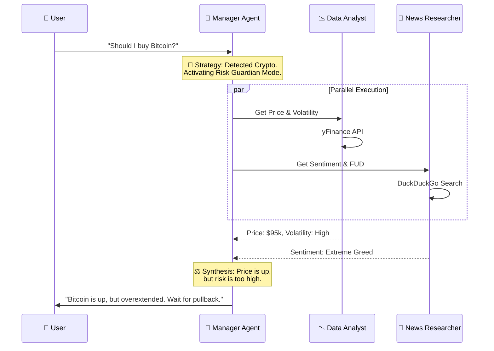

# Cofinance v2: local finance research workspace

> **Status, 2026-11-08:** a working local slice, not a calibrated or complete finance product.
> The honest checklist of what is done and what is not lives in [TODO.md](TODO.md); dashboard and API
> details are in [frontend/README.md](frontend/README.md). The original v1 Streamlit project is kept
> further down as an archive and is not what runs today.

Chat about stocks and crypto on your own PC. Python decides what to fetch, validates every number and
owns every side effect. Models only **classify** (route a question, judge a headline) or **narrate**
(word an answer from facts the tools returned). Nothing leaves the machine for inference: **no hosted LLMs.**

**Rules the code enforces**

- A number reaches an answer only if a tool output contains it. A rejected narration is replaced by the
  tools' own words, and the run map shows that fallback.
- A wording check rejects names and claim words the narrator was never shown.
- Research cannot write your watchlist. Only the explicit *Track* button does.
- Everything recorded is inspectable: each answer links to a run map of routing, tools, agents, guards and
  the accepted output. Missing and not-dispatched components are shown as such, never as success.

## Run it (Windows)

Double-click `run-dashboard.cmd`, then open <http://127.0.0.1:8878> in a regular browser. After a
frontend build, Node is not needed: `python -E -B -m ui.dashboard --port 8878`. The server listens on
loopback only. It needs the locally installed inference packages (do not use `python -S`).

## How an answer is made

Two clocks that never share a code path:

1. **News (Clock 1), started by a person, no scheduler:** official Apple and NVIDIA feeds -> pre-gate
   (quarantine, dedupe) -> GLiNER judge -> signal gate (ignore / digest / alert) -> `data/news.db`.
2. **Chat (Clock 2):** GLiNER router (intent + assets) -> Data Analyst and News Researcher -> team lead
   -> number guard + wording check -> accepted answer, or the deterministic fallback.

The specialists and the team lead can share one narrator through separate calls. Spidermonkey/Jev inspired
the gating pattern; no such service runs.

## Local models

| Model | Job | Notes |
| --- | --- | --- |
| `fastino/GLiNER2.5-Decide` (486,444,053 parameters) | route questions, judge headlines | pinned revision, offline from the local cache |
| LFM3 1.7B Q4_K_M on llama.cpp (CPU) | optional narrator | pinned hashes, must pass qualification; your choice is restored after a restart but **never loads until a run needs it** |
| Hy-Memory lite + Qwen3-Embedding-0.6B (Apache-2.0) | optional semantic memory | isolated venv, loopback only, tiktoken blocked, network trap showed zero outbound calls |

Downloads are explicit, resumable and hash-checked. Passing the small smoke suite does not establish
financial accuracy.

## Conversation memory

- **Default: hybrid.** Keyword search (SQLite FTS5) and Hy-Memory embeddings, fused by rank; if the semantic
  side is missing or fails, keyword answers and the trace says so. Override with
  `COFINANCE_MEMORY=keyword`, `hymemory` or `hybrid`.
- **Context only.** Recalled text helps the narrator follow a conversation. It is never evidence and its
  numbers never enter the number guard. Recall never crosses conversations and only uses turns about the same assets.
- **You are in control** (the brain button in the chat top bar, and *Forget from memory* under each answer):
  remember a short note (500 characters, about an asset named in the note or already in the conversation, 50 per conversation), forget one item, or forget a
  whole conversation. A forgotten item is blocked on every path first and its copies are deleted second, so even a
  failed delete can never bring it back. The answer stays in the chat history; the trace stays as the audit record.
  Notes reach the narrator in a separate block marked untrusted: not evidence and not instructions.
- **Delete a conversation** (trash icon on a row in *Conversations*, confirm inline) or **Clear all** (list icon in the
  panel header, confirm in a dialog). Unlike forget, this is permanent: memory is forgotten first (same tombstone and
  sweep path), then the tombstones lose their text, then messages, runs and the run traces are deleted. SQLite
  `secure_delete` zeroes the freed pages, so the text is not left readable in the database files. Refused while a run
  in that conversation, or its memory write, is still in flight. Watchlist, collected news and models are kept. A vector
  delete that fails stays pending and retries; the conversation is gone either way.
- **Evidence level.** Hybrid beat keyword 22/24 vs 17/24 on a synthetic follow-up set written by the people who
  built the backends (paraphrase-heavy, so biased toward embeddings); that is thin. Real chats now record what keyword
  alone would have recalled, and `data/_memory_shadow_report.py` decides after 30 real follow-ups under a rule fixed in advance.
- Design and review record: [docs/designs/remember_forget_draft.md](docs/designs/remember_forget_draft.md).

## What is not done

See [TODO.md](TODO.md) for the full list. The main gaps:

- **Labels and calibration.** The 131 labelled headlines in `data/news_corpus_20261108` were labelled by an AI model,
  not a person, and are recorded as such; only 18 of the 20 required traps exist. Calibrated thresholds failed the
  held-out check and were not adopted. Rule-based urgency runs in shadow mode only; its real test needs a fresh corpus on or after 2026-11-15.
- **Coverage.** Fundamentals are incomplete. News comes from the Apple and NVIDIA official feeds; there are no
  Bitcoin or regulatory sources and no scheduler yet (each needs approval). Reddit and StockTwits were tried through
  last30days and fail without a login, so they are not used.
- **Verification limits.** The wording check misses paraphrase that introduces no new name or claim word. GLiNER's
  direction label is uncalibrated. Numeric matching is not full factual verification.

## Checks

```text
python -m unittest discover -s tests -t .          # backend; some live tests are skipped by default
cd frontend && npm test && npm run build           # frontend tests, type-check, production build
```

Opt-in live checks: `COFINANCE_HYMEMORY_TESTS=1` (real Hy-Memory round trip and delete) and
`COFINANCE_BROWSER_TESTS=1` (Chrome/Playwright). Real-model runs are separate from fixtures and cannot be replaced by them.

## Layout

```text
core/        routing, orchestration, guards, tools, chat service, memory (ledger, keyword, Hy-Memory), local models
qualify/     corpus, label store, calibration, qualification scorers
ui/          loopback dashboard server and read-only workbench
frontend/    React + TypeScript + Vite + Tailwind v4 dashboard
tests/       backend tests
docs/designs/  design drafts and their review records
data/        local state, models, traces, corpora (git-ignored)
```

No commit, push, branch, PR or deployment is made by the tooling in this repo without explicit approval.

---

# 📈 Cofinance Analyst (archived v1)

Everything below describes the archived v1 Streamlit project. It is kept as a reference and is not the current implementation.


 

> **The Autonomous Investment Committee that lives in your browser.**

Note: Cofinance Analyst is an archived hackathon project and is no longer actively maintained. It stays up as a reference implementation for multi-agent orchestration with Phidata.
For actively maintained work, see AI Side Panel (12k+ installs, ChatGPT/Gemini/Claude in your browser side panel), and my other works → artistscompany.net

---

## 💡 The Pitch

### The Problem

Retail investors are drowning in noise. To analyze a single asset, you need to switch between **TradingView** for charts, **Yahoo Finance** for fundamentals, and **Twitter/News** for sentiment. It's a fragmented, cognitive nightmare that leads to bad decisions.

### The Solution

**Cofinance Analyst** is not just a chatbot—it's an **Agentic Orchestrator**. It unifies the entire financial research workflow into a single conversation. By coordinating a team of specialized AI agents, it delivers institutional-grade analysis, interactive visuals, and real-time data without you ever leaving the chat.

### The Value

* **Context-Aware Intelligence:** Automatically switches strategies based on asset class (e.g., analyzing **P/E** for Stocks vs. **Volatility** for Crypto).
* **Zero Hallucination Risk:** Agents are physically incapable of guessing data; they *must* use Python tools to fetch real-time prices and news.
* **Visual Alpha:** Generates interactive Plotly charts on the fly, bridging the gap between text and technical analysis.

---

## 🤖 Architecture

Cofinance uses a **Hub-and-Spoke** architecture where a central "Manager Agent" directs specialized workers.



## ✨ Key Features

### 1\. Hybrid Asset Intelligence 🧠

The system is smart enough to treat assets differently:

* **Stocks (AAPL, NVDA):** Focuses on Earnings, Revenue, and P/E Ratios.
* **Crypto (BTC, SOL):** Switches to **Risk Management Mode**, analyzing Fear & Greed Index, Distance from ATH, and Volatility.

### 2\. Interactive "Living" Charts 📊

No more static images. The Data Agent writes and executes Python code to generate **interactive Plotly charts** that you can zoom, pan, and hover over for exact price points.

### 3\. Persistent Portfolio Memory 💾

Unlike standard LLM chats that forget you instantly, Cofinance uses an **SQLite Database** to maintain your personal "Watchlist" across sessions.

* *Ask:* "How is **my** portfolio doing?"
* *Action:* Agent queries the DB, checks your specific tickers, and summarizes the news.

---

## 🛠️ Technical Implementation

This project demonstrates mastery of **Agentic AI** concepts:

* **Multi-Agent Orchestration:** Implemented via phidata using a Team Lead/Worker pattern.
* **Tool Use (Function Calling):** Custom Python tools for `yfinance`, `duckduckgo_search`, and `sqlite3`.
* **Structured Output:** Enforces strict "Strategy -\> Data -\> News -\> Verdict" response formats using System Prompt Engineering.
* **Observability:** Full visibility into agent thought processes via Streamlit expanders.

---


## 📸 Screenshots

| Feature    | Screenshot                             |
| ---------- | -------------------------------------- |
| Summary    |     |
| Deep Think |  |
| Response   |     |
| Watchlist  |   |
| Compare    |       |


## Video

[](https://youtu.be/FKFkU2BG5cY)

---

## 🚀 Quick Start

### Prerequisites

* Python 3.9+
* A Google Gemini API Key or LLM Studio or OpenRouter API Key

### Installation

1. **Clone the repo**

   ```bash
   git clone [https://github.com/creosb/Cofinance-analyst.git](https://github.com/cresoB/Cofinance.git)
   cd Cofinance-analyst
   ```
2. **Create a Virtual Environment** (Windows)

   ```pwsh
   python -m venv .venv
   .\.venv\Scripts\Activate.ps1
   ```
3. **Install Dependencies**

   ```bash
   pip install -r requirements.txt
   ```
4. **Set Up Keys**export GOOGLE_API_KEY="your_api_key_here"
5. **Run the App**

   ```bash
   python -m streamlit run app.py --browser.gatherUsageStats false
   ```

---

## 🧪 Testing

We use `pytest` to ensure our data tools are robust (especially the crypto-fallback logic).

```bash
pytest -q
```

---

## 📂 Project Structure

```text
Cofinance-analyst/
├── agents/             # Agent definitions (Manager, Data, News)
├── tools/              # Custom Python tools (yfinance, plotly)
├── storage/            # SQLite database logic
├── tests/              # Unit tests for tools
├── app.py              # Main Streamlit application
├── requirements.txt    # Pinned dependencies
└── README.md           # Documentation
```

---

## 🏆 Hackathon Submission Details

* **Track:** Finance Agent / Multi-Agent Systems
* **Framework:** Phidata
* **Model:** Google Gemini 2.5 Flash - Qwen 3 4b - gpt oss 20b

> *Built with ❤️ by Creos*


# License

---

## Please contact me first to share or make changes anywhere.
***
This work is licensed under a
[Creative Commons Attribution-NonCommercial-ShareAlike 4.0 International License][cc-by-nc-sa].

[![CC BY-NC-SA 4.0][cc-by-nc-sa-image]][cc-by-nc-sa]

[cc-by-nc-sa]: http://creativecommons.org/licenses/by-nc-sa/4.0/
[cc-by-nc-sa-image]: https://licensebuttons.net/l/by-nc-sa/4.0/88x31.png
[cc-by-nc-sa-shield]: https://img.shields.io/badge/License-CC%20BY--NC--SA%204.0-lightgrey.svg
***
