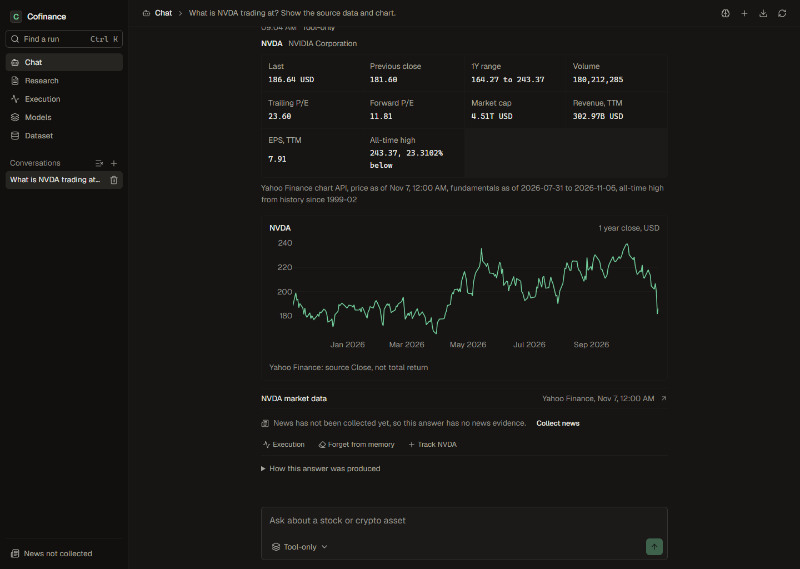
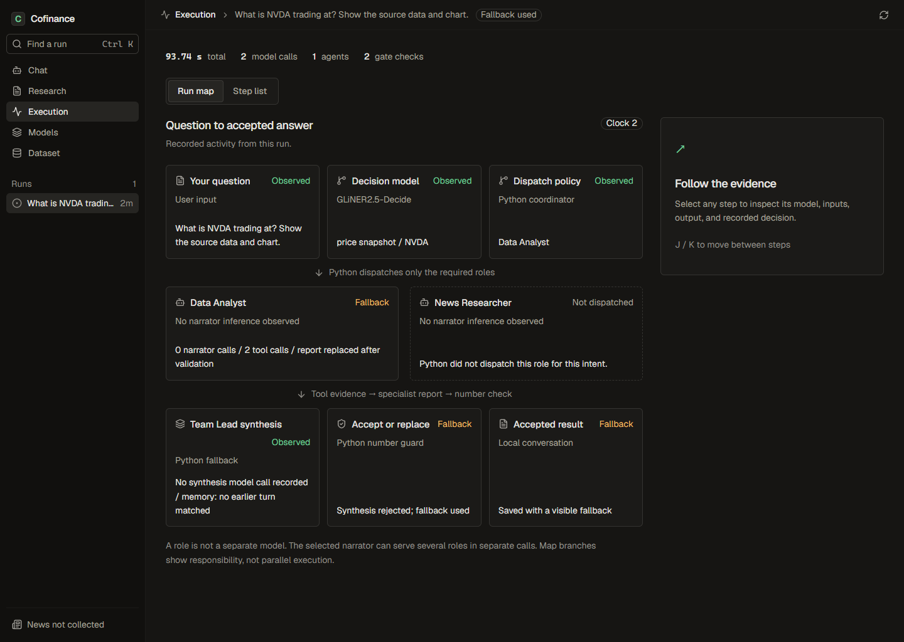

# Cofinance

A local finance-research workspace for stocks and crypto. Chat with specialist agents, inspect their evidence and decisions, and keep conversation memory on your PC.

**Current version: v2, in development.** React dashboard, Python policy, local inference. Not production-ready, not an automated trading system, and not financial advice.

[Start](#start) · [How-it-works](#how-it-works) · [Models-and-measurements](#models-and-measurements) · [Development](#development) · [Open-work](#open-work)

## Preview

Actual local UI, captured 2026-11-09 with a purpose-created public NVDA conversation. No private chats or notes are shown. This run uses real cached GLiNER routing and Yahoo market tools, with **tool-only narration** (not an LFM3 forecast).



Chat, source-backed figures and the locally rendered chart.



The same run's execution map. Unused narrator steps remain explicitly unused, not simulated as successful calls.

## Start

### On an already configured Windows PC

1. Double-click `run-dashboard.cmd` in the repository root.
2. Open <http://127.0.0.1:8878> in a regular browser. Keep the terminal open.
3. In **Models**, verify/qualify the narrator and select **LFM3 1.7B**. Tool-only reports remain available.
4. Collect news explicitly, then chat about an asset. Open the answer's run map to inspect sources, routing, model calls, guard checks and fallbacks.

The launcher builds the React frontend and starts the Python service. Node.js is needed for the build; Python and the local inference packages must already be installed. Do not start a second server if the address is already in use.

After a frontend build, serving does not need Node:

```text
python -E -B -m ui.dashboard --port 8878
```

This is not a fresh-install recipe. `requirements.txt` still mixes v1 and v2 dependencies, and the pinned GLiNER cache and optional Hy-Memory environment need separate setup. No Gemini, OpenRouter or other hosted-model key is needed for v2. See [dashboard setup and API details](frontend/README.md).

## How it works

Python owns dispatch, data fetching, validation, persistence and explicit writes. Models classify or narrate; they have no tool or write authority.

```text
News (Clock 1, manual collection)
  Official feeds -> pre-gate -> GLiNER judge -> Python signal gate -> local news store

Chat (Clock 2)
  Question -> GLiNER router -> Data Analyst / News Researcher -> Market Team Lead
           -> evidence guards -> accepted answer or deterministic fallback
```

- **Research:** provider-backed market snapshots, fundamentals, price charts and accepted news. Chat reads collected news; it does not silently refresh it.
- **Visibility:** inspect actual model calls, dispatch decisions, tool outputs, retries and validation. A missing step is not shown as successful. No hidden chain-of-thought is exposed or invented.
- **Conversations:** persistent history, cancellation, same-asset follow-ups and explicit asset tracking. Research never silently adds to the watchlist.
- **Memory:** hybrid keyword + Hy-Memory lite by default, with keyword fallback. Notes and recalled turns are context only, never financial evidence. Override with `COFINANCE_MEMORY=keyword`, `hymemory` or `hybrid`.
- **Controls:** remember a note, forget one item or a conversation's memory, delete a conversation, or clear all conversations. Forget keeps chat history; delete removes history and traces too. Watchlist, collected news and models are kept.

Detailed memory semantics and failure handling: [remember/forget design](docs/designs/remember_forget_draft.md).

## Models and measurements

### Active stack

| Component | Role | Runtime policy |
| --- | --- | --- |
| `fastino/GLiNER2.5-Decide` (486,444,053 parameters) | Route questions and classify headlines | Pinned local cache; no generated answers |
| **LFM3 1.7B, Q4_K_M** | Narrate specialist reports and team-lead answers | Selected narrator; pinned llama.cpp CPU runtime, qualification required |
| Hy-Memory lite + Qwen3-Embedding-0.6B | Semantic conversation recall | Optional local worker; keyword fallback |

The agent roles use separate calls to the shared narrator, not separate downloaded models. Spidermonkey/Jev inspired the gating pattern; no hosted Spidermonkey service runs.

**Decision, 2026-11-09: keep LFM3.** It remains the chosen quality-first narrator. MiniCPM5-1B is a smaller, faster option for future consideration, not a demonstrated quality upgrade. The comparison below does not change selection or add unqualified alternatives to the picker.

### Narrator smoke comparison

Measured locally on Nov 8-9, 2026. All models passed the existing narration and number-faithfulness smoke gates.

| Narrator (Q4_K_M) | Narration | Numbers | Narration median | Effective output tokens/s | Model file |
| --- | --- | --- | --- | --- | --- |
| **LFM3 1.7B (retained)** | 8/8 | 6/6 | 3.837 s | 9.5 | 1.100 GB |
| MiniCPM5-1B (candidate only) | 8/8 | 6/6 | 2.770 s | 13.9 | 0.688 GB |
| MiniCPM5-2B (candidate only) | 8/8 | 6/6 | 4.393 s | 5.4 | 1.561 GB |

Method: Ryzen 5 3600X, approximately 16 GB RAM, CPU-only, 6 threads, llama.cpp `b12110`, 4,096-token context, temperature 0, thinking off, 256-token output cap. Each arm ran all 23 synthetic cases twice (46 calls). Narrator gates cover only 4 narration + 3 number cases, repeated twice: **7 unique cases, not 14 independent examples**. Other categories test jobs these narrators do not own.

Effective tokens/s includes prompt processing and is aggregated across all cases, not raw decoding speed. Timings are indicative, not a controlled performance benchmark; dashboard activity may have affected the MiniCPM runs. GB is decimal file size, not RAM usage. This smoke set cannot establish comparative financial accuracy or overall model quality.

[Recorded scores, hashes and revisions](frontend/src/lib/narrator-benchmark.json). Full local reports stay under ignored `data/bakeoff_20261108/`.

### Decision-model experiment status

The 91-row training split has AI-generated labels, not human ground truth. Its held-out split was already used by calibration, so no new held-out result is claimed.

| Arm | Observed outcome | Meaning |
| --- | --- | --- |
| GLiNER alone | 72.5% materiality accuracy; macro-F1 0.667; AUC 0.790; 0 request errors | Provisional training baseline, not production accuracy |
| MiniCPM5-2B-Jev | 91/91 requests timed out under the current request budget | Integration/runtime failure; no valid quality comparison |
| d1-2B | Load failed due to an incompatible Transformers import | Blocked before inference; no quality score |

No judge replacement has been adopted. Downloaded model files are pinned and checksum-verified; that is not the same as a working, qualified model.

## Historical benchmark

**No predictive edge demonstrated in the first price-only experiment.** LFM3 predicted UP in all 125 cases, exactly matching the always-UP baseline. A simple trailing-momentum rule did better overall. The current production research pipeline does not issue scored forecasts; this is a benchmark-only LFM3 forecast arm, not a validation of the full app.

Next-five-US-session direction, with entry at the next session open. Fixed assets: AAPL, NVDA, MSFT, BTC and ETH. Completed outcomes through 2026-11-06:

| Historical slice | Sampled asset-windows | LFM3 accuracy | Always-UP | Momentum over 20 sessions |
| --- | --- | --- | --- | --- |
| Last 1 month | 20 | 20.0% | 20.0% | 65.0% |
| Last 3 months | 60 | 53.3% | 53.3% | 60.0% |
| Last 6 months | 125 | 51.2% | 51.2% | 53.6% |

All 125 inputs were processed: no request errors, abstentions or dropped predictions. The six-month sample is 25 time windows across five assets, not 125 independent market periods. The three slices overlap. LFM3's balanced accuracy is 50% in every slice.

Inputs use only past prices, with asset names and dates hidden from the model. Forecasts were sealed before evaluation; future prices and current news/fundamentals never enter the predictor. Historical data may still be retrospectively revised, and the model's training cutoff is unknown, so this is **not proof of contamination-free out-of-sample performance**. No price targets or full-news historical archive were tested. No model/prompt was tuned on these scores.

[Method and reproduction](docs/benchmarks/HISTORICAL.md) · [Measured report](docs/benchmarks/history-2026-11-09.json) · [Frozen protocol](docs/benchmarks/history-2026-11-09-protocol.json)

LFM3 remains the chosen **research narrator**, not an adopted trading signal. The useful next test is a separately frozen full-research replay with timestamped news and prospective forecasts, not tweaking this prompt until the old prices look good.

## Safety and local data

- **No hosted inference.** Model calls stay local; market providers and approved news/download sources still require network access.
- **Guarded output, not perfect verification.** Number/scale, wording, direction and supported-risk checks reject unsupported candidate text. At most one team-lead retry runs before fallback. Value matching and lexical checks do not prove every financial claim.
- **Explicit side effects.** Watchlist edits, collections, model downloads and conversation controls are user actions. The API binds to loopback and checks host, origin and request tokens.
- **Private local state.** `data/` contains databases, traces, models and corpora and is git-ignored. Memory stays within a conversation and the relevant assets. Deletion uses tombstones, vector sweeps and SQLite `secure_delete`; a failed vector delete stays pending for retry. This is not a guarantee of forensic erasure from backups or the device.

## Development

```text
python -m unittest discover -s tests -t .
cd frontend
npm ci --ignore-scripts
npm test
npm run build
```

The full backend suite needs the installed inference packages; live checks are opt-in. `COFINANCE_HYMEMORY_TESTS=1` enables real Hy-Memory checks and `COFINANCE_BROWSER_TESTS=1` enables installed-Chrome/Playwright checks. Fixtures do not replace real-model validation.

For frontend development, run the Python server, then `npm run dev` in `frontend/`. Vite uses loopback port 5173 and proxies the local API. See [frontend/README.md](frontend/README.md) for security boundaries and browser checks.

## Open work

The source of truth is [TODO.md](TODO.md), not a claim that v2 is finished. Main remaining gaps:

- Human-reviewed labels, two additional real traps, reliable calibration and a fresh rule-urgency test on or after **2026-11-15**. Current rules are live, but not yet validated on that fresh corpus.
- Repair the Jev timeout and d1 compatibility blockers before comparing optional judges or cascades.
- Broader narrator quality evaluation, and claim provenance beyond matching values, words and signs.
- More primary news coverage (Bitcoin/regulatory) and a bounded ongoing scheduler. Both need approval.
- Reproducible fresh installation, backup/recovery and production-readiness checks. CI is deliberately out of scope at Baris's request.

## Repository map

| Path | Purpose |
| --- | --- |
| `core/` | V2 routing, agents, tools, guards, services, memory and local models |
| `qualify/` | Corpus, label workflow, calibration and qualification |
| `frontend/` | React + TypeScript + Vite dashboard |
| `ui/` | Loopback server and read-only workbench |
| `tests/` | Backend regression tests |
| `docs/designs/` | Design notes and review records |
| `data/` | Private local state and evidence (git-ignored) |
| `app.py`, `agents/`, `tools/`, `storage/` | Historical v1 Streamlit implementation |

## History and license

[README.old.md](README.old.md) preserves the entire previous README, including the v1 pitch, screenshots, setup and historical claims. It is an archive, not current v2 guidance. The old application and its databases are preserved, not migrated.

Please contact the author first to share or make changes anywhere. This work retains its existing [Creative Commons Attribution-NonCommercial-ShareAlike 4.0 International license](http://creativecommons.org/licenses/by-nc-sa/4.0/). Model and runtime components have their own licenses; see their pinned sources and local license copies.
