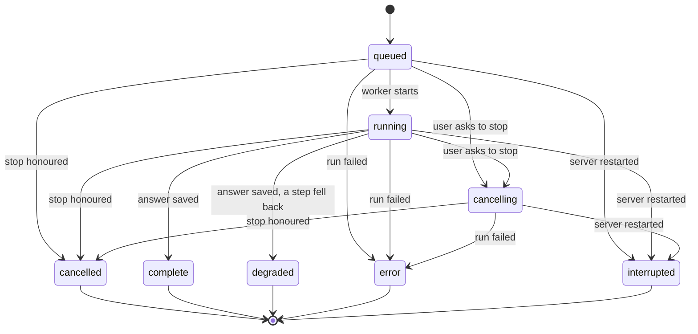

# State charts

The risky state machines, drawn from the code. `tests/test_job_statechart.py` fails if a diagram here no longer
matches the table it was drawn from, so review the picture, not the SQL.

## Chat job

Source: `NEXT` in `core/chat_store.py`. The store refuses every move not drawn here, so a late or repeated update
changes nothing. Only `complete` and `degraded` carry an answer, and only a running run can reach them. No end
state ever moves.

